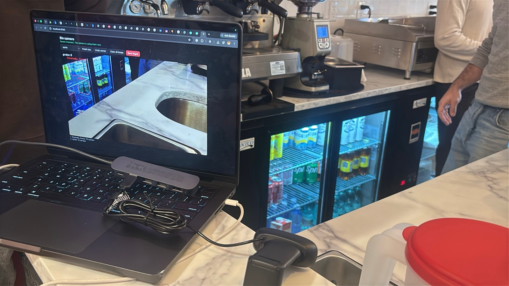
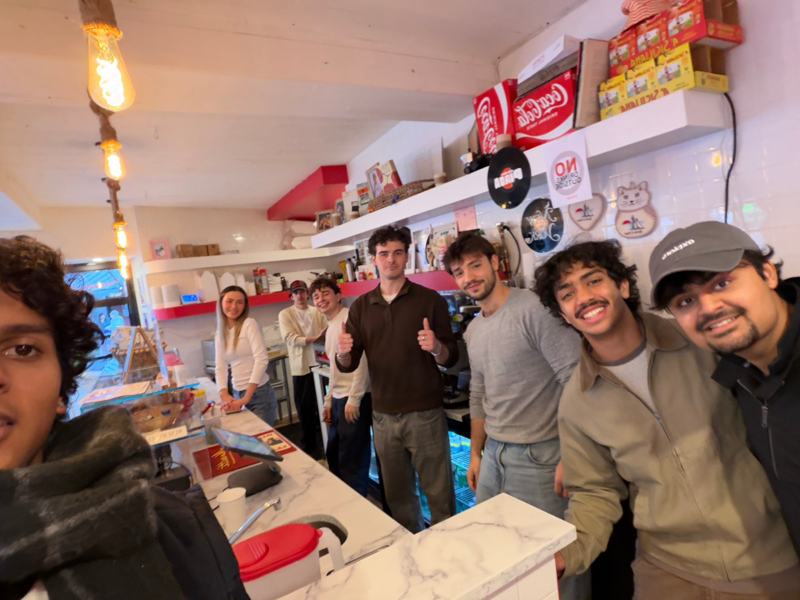

# Restock: the restaurant inventory that keeps itself

**A webcam watches a restaurant's shelves and an AI agent keeps the inventory, so the owner never counts by hand again: every grab is checked by a vision model and logged, and the owner runs the shop by text (stock, reorders, their Excel sheet).**
**We tested it live for 3 hours on the drinks fridge of a family Italian restaurant (the kitchen was off-limits), where one can = one unit makes every count exact and checkable.**


## At the restaurant: Casa Piada, Greenwich (Nov 14)
We worked with **Filippo Spagnesi (manager)** and **Abel Romero Corbalan (assistant manager)**. Filippo does the inventory by hand in Excel. **By their numbers, Restock would save them about $600 a week.** Details and evidence: [`docs/discovery/2026-11-14-casa-piada.md`](docs/discovery/2026-11-14-casa-piada.md).

| The setup | The team with the staff |
|---|---|
|  |  |

**One real grab, start to finish** ([35-second clip](docs/media/shop-grab-sprite.mp4)): someone takes a Sprite. About 5 seconds later the system has cut the clip below. d1 answered "took 1 sprite" (confidence 0.71), it was logged automatically, and Sprite stock went 24 → 23.


What 3 hours of live testing showed: d1 named the right drink on every real grab. Only the confident ones changed stock; the rest went to the owner's "Needs your OK" list rather than being guessed. Most low-confidence grabs came from people standing between the camera and the fridge, so the fix is mounting the camera higher. We keep one clip in the repo; the rest of the footage stays on our laptop.

## What it does
1. **Sees a grab.** Motion in a shelf zone cuts a before/during/after clip. Liquid **d1** (vision) says what was taken and how many: 1, 2, 3, or "more", which goes to the owner. **YOLO-World** checks that a hand was actually there. Confident grabs update stock; uncertain ones get a one-tap confirm.
2. **Texts the owner (Photon 2.0 iMessage).** "Sprite is at 2, par 6." A **LangChain deepagents** agent answers questions, proposes a reorder plan (every item, cost, total), and waits for "yes". Approved means **on order**: nothing is sent to a supplier, and stock rises when the owner says the delivery came.
3. **Keeps the owner's Excel sheet current.** "We counted 18 cokes" or "make water par 20" updates the real `.xlsx` and texts back a picture of it.
4. **Earns trust.** Every outgoing text is fact-checked by **d1 against the ledger**, and numbers are tied to the right item in code.

## Architecture
```
 SHOP: Arduino UNO Q                 LAPTOP (server, agent, dashboard)
 ───────────────────                 ─────────────────────────────────
 webcam ──USB──▶ hardware/main.py    motion (MOG2 + frame diff) per shelf zone
 (C270)          grab cutter         → before.jpg, 6× during, after.jpg, meta.json
                 live view :8090     (browser box editor, password protected)
                      │ POST /api/grabs/upload (one package per grab, retried until accepted)
                      ▼
                 app/api (FastAPI :8000) ── watcher thread
                      │   ├─ YOLO-World: was a hand in the zone?            (local)
                      │   └─ Liquid d1:  took / put back / touched, which item, how many   (OpenRouter)
                      ▼
                 Postgres ledger: items, counts, grab_events, orders, purchases, sales
                 (all arithmetic in SQL/Python, never by a model)
                      │
     ┌────────────────┼──────────────────────────────┐
     ▼                ▼                              ▼
 deepagents agent   dashboard (Streamlit :8501)    exports/Inventory.xlsx
 (gpt-oss-120b)     stock, reorder, flagged        (Inventory · Orders · Camera log,
  ├ subagents: analyst, purchasing, read-only general   live formulas; picture texted back)
  ├ tools: stock, variance, grabs, d1_look, counts, par, reorder plan, orders, delivery
  ├ middleware: d1 fact-check guard on every text · human-in-the-loop on orders · model fallback
  ├ memory: /memories/ in Postgres (owner preferences, corrections)
     │
     ▼
 photon-bridge (Node, Photon 2.0 API) ⇄ owner's iPhone (iMessage)
```

## Run it (one laptop)
Each box gets the right questions automatically: exact counts (1, 2, 3, more) for cans and bottles, pinch / handful for bulk food.
```bash
scripts/db_up.sh && uv run python scripts/seed_demo.py --reset          # Postgres + demo week
uv run uvicorn app.api.server:app --host 0.0.0.0 --port 8000           # API + grab watcher + alerts
cd dashboard && API_URL=http://localhost:8000 uv run streamlit run app.py     # dashboard
cd photon-bridge && npm start                                           # iMessage line (needs .env)
cd hardware && python main.py --camera 0 --source webcam --stream-port 8090 --api-url http://127.0.0.1:8000   # camera + live view/box editor
```
Keys go in `.env` (see `.env.example`): `OPENROUTER_API_KEY` (agent model + d1), `AGENT_MODEL=openrouter:openai/gpt-oss-120b`, `D1_BACKEND=openrouter`, `LANGSMITH_API_KEY`. Photon: `photon-bridge/.env`.

## Docs
- `docs/discovery/2026-11-14-casa-piada.md`: the restaurant, who we worked with, the evidence
- `hardware/UNO_Q.md`: running the camera on the Arduino UNO Q
- `app/agent/README.md`: the agent
