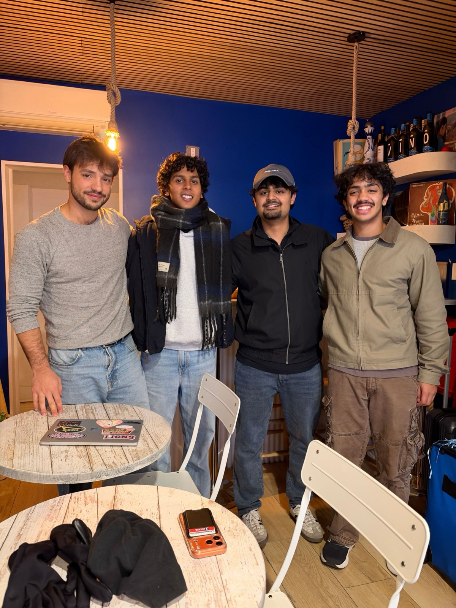
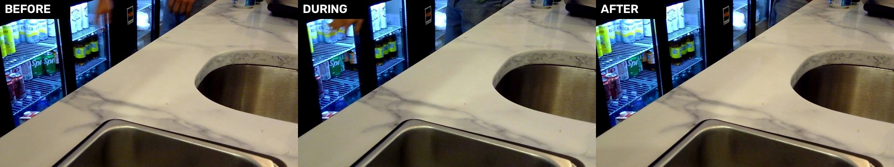

# Princeton Hacks: the restaurant inventory that keeps itself

**A webcam watches a restaurant's shelves and an AI agent keeps the inventory, so the owner never counts by hand again: every grab is checked by a vision model and logged, and the owner runs the shop by text (stock, reorders, their Excel sheet, even the bank balance behind a code).**
**We tested it live for 4 hours on the drinks fridge of a family Italian restaurant (the kitchen was off-limits), where one can = one unit makes every count exact and checkable.**



## At the restaurant (Nov 14)
| The setup | The team with the staff |
|---|---|
|  |  |

**One real grab, start to finish** ([35-second clip](docs/media/shop-grab-sprite.mp4)): someone takes a Sprite. About 5 seconds later the system has cut the clip below. d1 answered "took 1 sprite" (confidence 0.71), it was logged automatically, and Sprite stock went 24 → 23.



What 4 hours of live testing showed, honestly: d1 named the right drink on every real grab. Only the confident ones changed stock; the rest went to the owner's "Needs your OK" list rather than being guessed. Most low-confidence grabs came from people standing between the camera and the fridge, so the fix is mounting the camera higher. We keep one clip in the repo; the rest of the footage stays on our laptop.

## What it does
1. **Sees a grab.** Motion in a shelf zone cuts a before/during/after clip. Liquid **d1** (vision) says what was taken and how many: 1, 2, 3, or "more", which goes to the owner. **YOLO-World** checks that a hand was actually there. Confident grabs update stock; uncertain ones get a one-tap confirm.
2. **Texts the owner (Photon 2.0 iMessage).** "Sprite is at 2, par 6." A **LangChain deepagents** agent answers questions, proposes a reorder plan (every item, cost, total), and waits for "yes". Approved means **on order**: nothing is sent to a supplier, and stock rises when the owner says the delivery came.
3. **Keeps the owner's Excel sheet current.** "We counted 18 cokes" or "make water par 20" updates the real `.xlsx` and texts back a picture of it.
4. **Earns trust.** Every outgoing text is fact-checked by **d1 against the ledger**, and numbers are tied to the right item in code. Bank info is locked behind the owner's **authenticator-app code**. The code never reaches the AI; 3 wrong tries locks it; it re-locks after 10 minutes; bank amounts can't leave a locked chat by any path.

## Architecture
```
 SHOP                                LAPTOP (one machine runs everything below)
 ────                                ──────────────────────────────────────────
 webcam ──USB──▶ hardware/main.py    motion (MOG2 + frame diff) per shelf zone
 (C270)          grab cutter         → before.jpg, 6× during, after.jpg, meta.json
                 live view :8090     (browser box editor, password protected)
                      │ POST /api/grabs/upload (one package per grab, retried until accepted)
                      ▼
                 app/api (FastAPI :8000) ── watcher thread
                      │   ├─ YOLO-World: was a hand in the zone?            (local)
                      │   └─ Liquid d1:  took / put back / touched, which item, how many   (OpenRouter)
                      ▼
                 Postgres ledger: items, counts, grab_events, orders, purchases, sales
                 (all arithmetic in SQL/Python, never by a model)
                      │
     ┌────────────────┼──────────────────────────────┐
     ▼                ▼                              ▼
 deepagents agent   dashboard (Streamlit :8501)    exports/Inventory.xlsx
 (gpt-oss-120b)     stock, reorder, flagged        (Inventory · Orders · Camera log,
  ├ subagents: analyst, purchasing, read-only general   live formulas; picture texted back)
  ├ tools: stock, variance, grabs, d1_look, counts, par, reorder plan, orders, delivery, bank
  ├ middleware: d1 fact-check guard on every text · human-in-the-loop on orders · model fallback
  ├ memory: /memories/ in Postgres (owner preferences, corrections)
  └ security gate: authenticator (TOTP) checked in code; bank amounts filtered at emission
     │
     ▼
 photon-bridge (Node, Photon 2.0 API) ⇄ owner's iPhone (iMessage)
```

## How we built it
- **Day 1, Fri night:** interviewed the restaurant, picked the problem (hours a day of manual inventory into Excel), designed the pipeline, and had Codex adversarially review the architecture twice before writing code.
- **The vision check:** we tried d1 on full frames first, and it couldn't see a small bin. We now crop to the zone, ask d1 separate questions (what changed, which item, how many), and only auto-log when every answer is confident. YOLO-World adds a cheap "was there a hand?" check.
- **The camera code was rebuilt from failures.** Realistic-video tests caught a "before" frame taken mid-grab, long rummages split in two, a paused hand learned as background in 1.3 s, and endless motion that never ended a grab. Each became a test (`tests/test_pi_pipeline.py`).
- **The fact-check guard:** we calibrated it on 24 labeled claims (sends 11/12 true, 0/12 false). d1 is weak at arithmetic, so numbers are checked in code and tied to the item they're said about.
- **Photon:** our first bridge used Photon's older SDK, which rejected our 2.0 project, so we ported it to the Photon 2.0 API (`photon-bridge/src/photon2.ts`). It was verified live from a real iPhone.
- **Security:** we had Codex attack the bank-code gate. It found 13 issues; we fixed 10 and documented the rest (`docs/struggles.md`).
- **Day 2, Sat:** 4 hours live at the restaurant on the drinks fridge, then fixed what we saw: exact can counts, "on order" vs "on the shelf", and the read-only subagent.
- **Tests:** 125 core + 49 hardware + 10 dashboard + 25 bridge, plus 14 end-to-end runs on the real models.

## Run it (one laptop)
The drinks test runs with `SCENE=drinks` (d1 is asked about cans and bottles); the default is the pizza make-line.
```bash
scripts/db_up.sh && uv run python scripts/seed_demo.py --reset          # Postgres + demo week
uv run uvicorn app.api.server:app --host 0.0.0.0 --port 8000           # API + grab watcher + alerts
cd dashboard && API_URL=http://localhost:8000 uv run streamlit run app.py     # dashboard
cd photon-bridge && npm start                                           # iMessage line (needs .env)
cd hardware && python main.py --camera 0 --source webcam --stream-port 8090 --api-url http://127.0.0.1:8000   # camera + live view/box editor
uv run python scripts/setup_authenticator.py                           # once: link the owner's authenticator app
```
Keys go in `.env` (see `.env.example`): `OPENROUTER_API_KEY` (agent model + d1), `AGENT_MODEL=openrouter:openai/gpt-oss-120b`, `D1_BACKEND=openrouter`, `LANGSMITH_API_KEY`. Photon: `photon-bridge/.env`.

## Tests
```bash
uv run pytest -q                              # 125 unit/integration tests, no paid APIs
RUN_E2E=1 uv run pytest tests/e2e -q -s       # real models end to end -> docs/e2e-report.md
(cd hardware && uv run --project .. python -m pytest -q tests)   # 39 Pi tests
(cd dashboard && uv run pytest -q)            # 10
(cd photon-bridge && npm test)                # 25
```

## Docs
- `docs/hackathon/README.md`: each sponsor's criteria, and what we show for it
- `docs/STATUS.md`: what's done, what's left
- `docs/architecture.md`, `docs/handoff.md` (Pi ↔ laptop)
- `docs/arnav-shah.md` (Photon/dashboard contract)
- `docs/struggles.md`: what broke and how we fixed it
- `docs/e2e-report.md`: the latest real-model run
- `docs/guard-calibration.md`, `docs/reviews/`
